# Multi-Agent Incremental Go Modernization & Project Build Framework

This directory contains autonomous **Action Files** designed to be handed over to AI coding agents (such as Claude Code, Cursor Agent, Antigravity, or CI/CD autonomous runners) independently and executed incrementally.

Together, these action files provide an end-to-end blueprint to bootstrap the repository from scratch and modernize any Go codebase across four deterministic phases.

---

## 1. The Action Files Suite

| Phase | Action File | Focus Domain | Agent Role | Output Verification Gate |
| :---: | :--- | :--- | :--- | :--- |
| **00** | [`00-project-setup.action.md`](00-project-setup.action.md) | **Project Setup & Environment Initialization**<br>Scaffolds all marketplace manifests (`.agents`, `.claude-plugin`, `.cursor-plugin`), plugin descriptors, and registers the `modern-go` skill. | DevOps & Repository Architect | `JSON.parse` schema validation & directory tree verification |
| **01** | [`01-go-core-data-structures.action.md`](01-go-core-data-structures.action.md) | **Core Language, Collections & Data Manipulation**<br>`slices`, `maps`, `min`/`max`, `cmp.Or`, `clear()`, `range int`, `iter.Seq`, `json/v2`, `new()`. Features decision matrices for lookup strategies and memory zeroing. | Core & Collections Specialist | `go build ./...`<br>`go vet ./...` |
| **02** | [`02-go-concurrency-systems.action.md`](02-go-concurrency-systems.action.md) | **Concurrency, Systems & Networking Architecture**<br>`sync.WaitGroup.Go`, typed atomics, `context.WithCancelCause`, `ServeMux` patterns, `os.OpenRoot`, `netip`. Features decision matrices for goroutine orchestration and lock-free pointers. | Concurrency & Systems Specialist | `go build ./...`<br>`go test -race ./...` |
| **03** | [`03-go-errors-testing-observability.action.md`](03-go-errors-testing-observability.action.md) | **Error Resilience, Testing & Observability**<br>Left-aligned happy path, `errors.Join`, `errors.AsType`, `b.Loop()`, `t.Context()`, `synctest`, `log/slog`. Features decision matrices for error propagation and structured log attributes. | Errors, Testing & Observability Specialist | `go test -v -race ./...`<br>`go test -bench=. ./...` |

---

## 2. Multi-Agent Handover & Incremental Architecture

The framework operates as a deterministic pipeline where each agent executes its isolated domain and produces a structured handover artifact for the next agent:

```mermaid
flowchart TD
    Setup["actions/00-project-setup.action.md"] --> P0["Agent 0: Scaffold & Plugin Manifests"]
    P0 --> Gate0{"JSON & Structure Valid"}
    Gate0 -- PASS --> Rep0["handover-phase-0-report.md"]

    Rep0 --> P1["Agent 1: Core & Collections"]
    subgraph Phase1["actions/01-go-core-data-structures.action.md"]
        P1 --> CheckVer["Inspect go.mod Target Version"]
        CheckVer --> Refactor1["Refactor Slices, Maps, Built-ins, Iterators"]
        Refactor1 --> Gate1{"go build & go vet"}
        Gate1 -- PASS --> Rep1["handover-phase-1-report.md"]
    end

    Rep1 --> P2["Agent 2: Concurrency & Systems"]
    subgraph Phase2["actions/02-go-concurrency-systems.action.md"]
        P2 --> Refactor2["Refactor WaitGroup.Go, Atomics, Mux Routes, os.Root"]
        Refactor2 --> Gate2{"go test -race"}
        Gate2 -- PASS --> Rep2["handover-phase-2-report.md"]
    end

    Rep2 --> P3["Agent 3: Errors, Testing & Observability"]
    subgraph Phase3["actions/03-go-errors-testing-observability.action.md"]
        P3 --> Refactor3["Refactor Guard Clauses, errors.Join/AsType, b.Loop, t.Context, slog"]
        Refactor3 --> Gate3{"Full Test Suite & Benchmarks"}
        Gate3 -- PASS --> FinalRep["final-modernization-audit-report.md"]
    end

    FinalRep --> Done["Production-Ready Merge to main"]
```



---

## 3. How to Dispatch to Agents

### Multi-Agent Autonomous Delegation
When dispatching in an agentic workflow:
1. **Agent 0 (Setup)**:
   > *"Execute `actions/00-project-setup.action.md`. Verify all JSON manifests and directories, then produce `handover-phase-0-report.md`."*
2. **Agent 1 (Core & Collections)**:
   > *"Read `handover-phase-0-report.md` and execute `actions/01-go-core-data-structures.action.md`. Verify with `go vet ./...` and produce `handover-phase-1-report.md`."*
3. **Agent 2 (Concurrency & Systems)**:
   > *"Read `handover-phase-1-report.md` and execute `actions/02-go-concurrency-systems.action.md`. Verify with `go test -race ./...` and produce `handover-phase-2-report.md`."*
4. **Agent 3 (Errors, Testing & Slog)**:
   > *"Read `handover-phase-2-report.md` and execute `actions/03-go-errors-testing-observability.action.md`. Run all unit tests and benchmarks, then output `final-modernization-audit-report.md`."*

### Single-Agent Staged Execution
If a single agent modernizes a repository sequentially:
```bash
# Phase 0: Setup
# Scaffolding and manifests
git commit -m "chore(setup): initialize multi-platform plugins and short-named skill modern-go"

# Phase 1: Core Data Structures
# Slices, maps, built-ins, iterators
git commit -m "chore(modernize): phase 1 - core language and collections"

# Phase 2: Concurrency & Systems
# Atomics, WaitGroup.Go, HTTP ServeMux, os.Root
git commit -m "chore(modernize): phase 2 - concurrency, systems, and networking"

# Phase 3: Error Handling, Testing & Observability
# Guard clauses, errors.Join, b.Loop(), t.Context(), slog
git commit -m "chore(modernize): phase 3 - errors, tests, benchmarks, and structured logging"
```

---

## 4. Short-Named Skill Registry
The core skill has been standardized to the short, memorable name:
- **Skill Name**: `modern-go`
- **Location**: `plugin/skills/modern-go/SKILL.md`
- **Description**: Automatically detects `go.mod` version and enforces modern Go idioms across all edits and refactorings.
